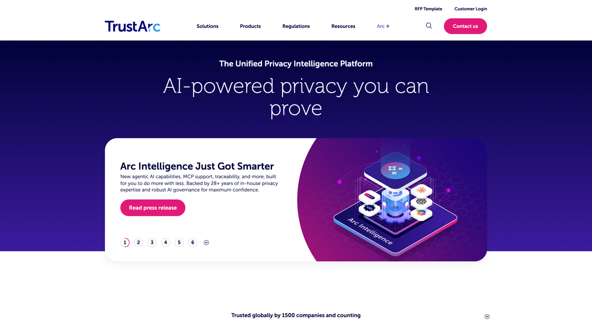
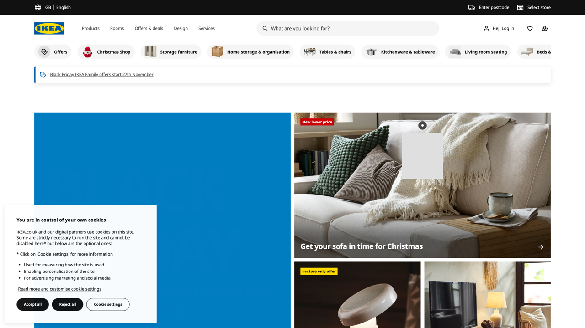
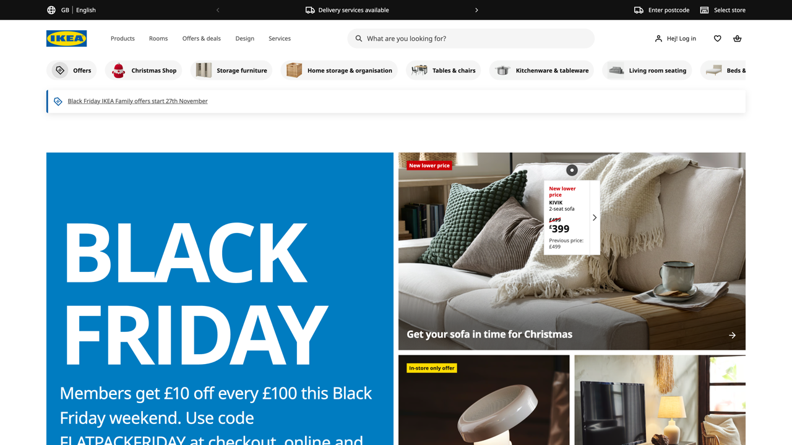

# DiffTrail — Website Screenshot API

A screenshot API for capturing web pages with configurable cookie-banner, popup, and ad blocking. Built with TypeScript, Playwright, and AdGuard.

## See cleanup in action

Real captures of live sites through DiffTrail, with the same request except `cleanup`.

| Raw capture · `cleanup:"none"` | Cookie and popup filtering · `cleanup:"standard"` |
| :---: | :---: |
|  |  |
|  |  |

Captured 25 November 2026 from one network at 1920×1080. Filtering varies by site and visit; page content such as carousels and lazy-loaded images can also differ between captures.

## Take a screenshot

With the [API running](#getting-started), send a URL and choose a cleanup preset:

```sh
curl --fail-with-body http://127.0.0.1:3000/api/screenshot \
  -H 'Content-Type: application/json' \
  -d '{"url":"https://example.com","cleanup":"standard"}' \
  --output screenshot.png
```

Open `screenshot.png` in your image viewer (`open screenshot.png` on macOS). Errors return JSON, so check that curl succeeded before opening the file.

### Wait for page content

Use loading controls for pages with delayed content or lazy-loaded images:

```json
{"url":"https://example.com","fullPage":true,"waitUntil":"domcontentloaded","scroll":true,"delay":1000,"timeout":60000}
```

Pixel density stays at 2× by default; use `scale:1` for smaller images. Full-page requests scroll automatically unless `scroll:false` is passed, and captures briefly wait for relevant images within a bounded budget. You can also wait for a visible CSS selector with `waitForSelector`. See [loading controls](docs/api.md#loading-controls) for options, bounds, and timeout behavior.

### Capture an element or rectangle

```json
{"url":"https://example.com","selector":"h1","cleanup":"standard"}
```

```json
{"url":"https://example.com","clip":{"x":100,"y":200,"width":600,"height":400}}
```

Selectors capture the first match. Rectangles use document CSS pixels; the default 2× density doubles output dimensions. Missing targets and invalid bounds return errors. See [element and rectangle capture](docs/api.md#element-and-rectangle-capture) for loading behavior and limits.

## Features

- Capture URLs as PNG, JPEG, or WebP, at a chosen viewport size or as a full page.
- Capture a specific element or a rectangle using document coordinates.
- Choose raw screenshots, cleanup presets, or individual filter categories.
- Run headless or open a visible browser for debugging.
- Inspect cleanup status, residual UI signals, and timings in response headers.
- Isolate cookies and storage between captures.

Cleanup uses bundled, maintained AdGuard filters. No API key is required.

## Use cases

- **Website previews:** generate page thumbnails for bookmarks, directories, and link cards.
- **Documentation:** capture web pages for guides and automated documentation workflows.
- **Visual archives:** save PNG snapshots of a page at a point in time.
- **AI workflows:** supply webpage screenshots as image inputs to vision models and agents.

## Getting started

Requirements: Node.js 22.18+, npm 10.9.11, and `unzip`.

```sh
npm ci
npm run setup:adguard
cp .env.example .env
npm start
```

The API runs at `http://127.0.0.1:3000`. Set `PORT` in `.env` to change the port. Setup installs Chromium and builds the bundled filtering runtime. For raw screenshots only, use `npm run setup:browser` instead.

On Linux, install Chromium’s system dependencies with:

```sh
npm exec --workspace=server -- playwright install --with-deps chromium
```

Windows contributors can use WSL2.

## Cleanup options

| `cleanup` | Behavior |
| --- | --- |
| Omitted or `"none"` | Raw screenshot; this is the default. |
| `"standard"` | Cookie-banner and popup filters. |
| `"all"` | All supported filter categories. |
| An object | Enable specific categories; omitted categories are off. |

```json
{"url":"https://example.com","cleanup":{"cookies":true,"popups":true,"ads":false}}
```

Filtering can change page content and layout. AdGuard’s cookie rules can interact with consent banners. Coverage varies by website.

See the [API reference](docs/api.md) for all categories, response headers, errors, and resource limits.

## Development

```sh
npm run dev              # Watch and run TypeScript source
npm run typecheck        # Check source and test types
npm run build            # Compile the server into apps/server/dist
npm test                 # Build and run local fixture tests
npm run test:adguard     # Include native AdGuard integration tests after setup
npm run audit:dependencies
```

`npm start` builds and runs the compiled server. GitHub Actions runs type checking, compilation, the dependency audit, and fixture and native integration tests.

To debug captures in a visible browser:

```sh
DIFFTRAIL_HEADLESS=false npm start
```

Use [the benchmark guide](docs/benchmarks.md) for manual comparison tooling. Live-site benchmarks are separate from the automated test suite.

## Current scope

DiffTrail supports viewport and full-page screenshots as PNG, JPEG, or WebP. Caching, consent-rejection automation, and AI cleanup are not implemented.

The server binds to loopback and is intended for local development. Public hosting still requires authentication, outbound network isolation, abuse controls, and resolution of the advisory in the [dependency review](docs/dependency-audit.md).

## Contributing

Use TypeScript for server changes, include relevant fixture checks, and follow [AGENTS.md](AGENTS.md) for verification and pull request conventions. Keep generated browser profiles, screenshots, and benchmark artifacts out of commits.
